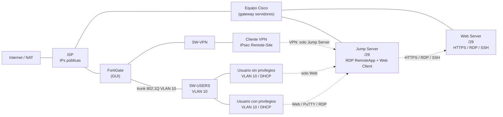

# Práctica #3 — Infraestructura #2: FortiGate, VPN IPsec y Jump Server con RDP RemoteApp

- **Asignatura:** Seguridad de Redes
- **Estudiante:** Luis Roble
- **Matrícula:** 2025-2168

Video: <https://youtu.be/XXXXXXXXXXX>

---

## 1. Objetivo

En esta práctica monté un escenario con un **FortiGate** (toda la configuración y la demostración las hice por GUI), un **equipo de red Cisco**, un **ISP** con IPs públicas y dos servidores: un **Web Server** (sistema de caja) y un **Jump Server**, cada uno en su propia LAN `/29`.

Lo que quise lograr:

- Una **VPN IPsec Remote-Site** entre el cliente y el servidor que **solo me da acceso al Jump Server**.
- Que el **Jump Server** solo llegue a estos servicios del Web Server: **HTTPS, RDP y SSH**.
- Dos usuarios en la **VLAN 10** (`/25`) con DHCP y permisos distintos:
  - **Sin privilegios:** solo tiene publicado el servicio **Web** en el Jump Server, y le puse políticas explícitas que le restringen el acceso SSH a los servidores.
  - **Con privilegios:** tiene publicados **Web, PuTTY y RDP** en el Jump Server.
- El servicio **RDP RemoteApp** y el **RDP RemoteApp Web Client** configurados en el Jump Server.

---

## 2. Topología


### Diagrama lógico



---

## 3. Direccionamiento

| Equipo | Interfaz | Dirección |
| --- | --- | --- |
| ISP | hacia FortiGate | `[IP pública]/[máscara]` |
| ISP | hacia Cisco | `[IP pública]/[máscara]` |
| FortiGate | WAN | `[IP pública]/[máscara]` |
| FortiGate | VLAN 10 (usuarios) | `[IP]/25` |
| FortiGate | VPN / LAN | `[IP]/[máscara]` |
| Equipo Cisco | WAN | `[IP pública]/[máscara]` |
| Equipo Cisco | LAN Web Server | `[IP]/29` |
| Equipo Cisco | LAN Jump Server | `[IP]/29` |
| Web Server | NIC | `[IP]/29` |
| Jump Server | NIC | `[IP]/29` |
| Usuarios VLAN 10 | DHCP | `[rango]/25` |
| Clientes VPN | pool | `[rango]` |

---

## 4. Herramientas

- [GNS3 / EVE-NG]
- FortiGate VM [versión], configurado por GUI
- Cisco IOS [versión] (equipo de red e ISP) y switches
- Windows Server para el Jump Server (RDP RemoteApp + Web Client)
- Ubuntu para el Web Server y los usuarios
- PuTTY, cliente RDP y cliente VPN

---

## 5. Configuración

### 5.1 ISP

El ISP entrega las IPs públicas y tiene rutas hacia las redes de la práctica.


Config completa: [`Configs/ISP-2168.txt`](Configs/ISP-2168.txt)

### 5.2 Switch de usuarios (VLAN 10)

Creé la VLAN 10 para los usuarios y dejé un trunk 802.1Q hacia el FortiGate.


Config completa: [`Configs/SW-USERS.txt`](Configs/SW-USERS.txt)

### 5.3 Switch de VPN


Config completa: [`Configs/SW- VPN.txt`](Configs/SW-%20VPN.txt)

### 5.4 Equipo de red Cisco

Conecta las LAN de los servidores (Web Server y Jump Server, cada uno con su `/29`) con el ISP.

Config completa: [`Configs/CISCO-2168.txt`](Configs/CISCO-2168.txt)

### 5.5 FortiGate (todo por GUI)

**Interfaces y redes**


**Objetos (addresses)**


**Rutas estáticas**


**Políticas de firewall**


Resumen de la lógica de políticas que apliqué:

| Política | Origen → Destino | Servicio | Acción |
| --- | --- | --- | --- |
| VPN → Jump Server | VPN-REMOTE → Jump Server | [servicios] | ACCEPT |
| Jump → Web Server | Jump Server → Web Server | HTTPS, RDP, SSH | ACCEPT |
| Usuario sin privilegios → Jump | [IP] → Jump Server | Web | ACCEPT |
| Usuario con privilegios → Jump | [IP] → Jump Server | Web, PuTTY (SSH), RDP | ACCEPT |
| Deny SSH usuario sin privilegios | [IP] → Servidores | SSH | **DENY** (explícita) |

El orden importa: las reglas DENY explícitas las puse por encima de las ACCEPT generales.

**Jump Server → Web Server (HTTPS, RDP, SSH)**


Config completa: [`Configs/FortiGate.conf`](Configs/FortiGate.conf) (sin claves ni contraseñas).

### 5.6 VPN IPsec Remote-Site


- Autenticación: [PSK / XAUTH / certificado]
- Fase 1: [versión IKE, modo y propuestas]
- Fase 2: [propuestas]
- Pool de clientes: `[rango]`
- Acceso permitido: **únicamente el Jump Server**

### 5.7 Servidores

**Web Server (sistema de caja)**, en su propia LAN `/29`.


**Jump Server**, en su propia LAN `/29`, con RDP RemoteApp y RDP RemoteApp Web Client.


### 5.8 Usuarios (VLAN 10 con DHCP)

- **Sin privilegios:** solo ve publicado el servicio Web del Jump Server, y tiene políticas explícitas que le bloquean el SSH hacia los servidores.
- **Con privilegios:** tiene publicados Web, PuTTY y RDP en el Jump Server.

---

## 6. Validación

### 6.1 Usuario sin privilegios

Solo tiene acceso al servicio Web del Jump Server.


Prueba de puertos desde este usuario:


### 6.2 Usuario con privilegios

Tiene publicados Web, PuTTY y RDP en el Jump Server.


### 6.3 SSH desde Windows al servidor Ubuntu


### 6.4 Pruebas de puertos (true / false)

Verifiqué qué puertos responden y cuáles no, incluyendo el 80.


### 6.5 Logs y reportes del FortiGate

Evidencia del tráfico permitido y bloqueado.


### 6.6 Tabla de pruebas

| # | Prueba | Resultado esperado |
| --- | --- | --- |
| 1 | VPN → Jump Server | Permitido |
| 2 | VPN → Web Server directo | Bloqueado |
| 3 | Jump → Web Server por HTTPS / RDP / SSH | Permitido |
| 4 | Jump → Web Server por otro puerto | Bloqueado |
| 5 | Usuario sin privilegios → Web del Jump | Permitido |
| 6 | Usuario sin privilegios → SSH a servidores | Bloqueado |
| 7 | Usuario con privilegios → Web, PuTTY y RDP en el Jump | Permitido |
| 8 | DHCP en VLAN 10 | IP asignada |

---

## 7. Configuraciones

Carpeta [`Configs/`](Configs):

| Archivo | Equipo |
| --- | --- |
| `CISCO-2168.txt` | Equipo de red Cisco |
| `FortiGate.conf` | FortiGate |
| `ISP-2168.txt` | ISP |
| `SW- VPN.txt` | Switch de VPN |
| `SW-USERS.txt` | Switch de usuarios (VLAN 10) |

---

## 8. Resultado

- Configuré el FortiGate completamente por GUI.
- La **VPN solo me da acceso al Jump Server**.
- El **Jump Server solo alcanza HTTPS, RDP y SSH** del Web Server.
- El **usuario sin privilegios** solo usa el servicio Web del Jump Server y no puede hacer SSH a los servidores.
- El **usuario con privilegios** accede a Web, PuTTY y RDP en el Jump Server.
- RDP RemoteApp y RemoteApp Web Client quedaron funcionando.

---

## Estructura del repositorio

```
PRACTICA-3-INF-2/
├── README.md
├── Configs/
│   ├── CISCO-2168.txt
│   ├── FortiGate.conf
│   ├── ISP-2168.txt
│   ├── SW- VPN.txt
│   └── SW-USERS.txt
└── IMAGENES/
    └── (capturas de topología, FortiGate, switches, VPN, servidores y pruebas)
```
