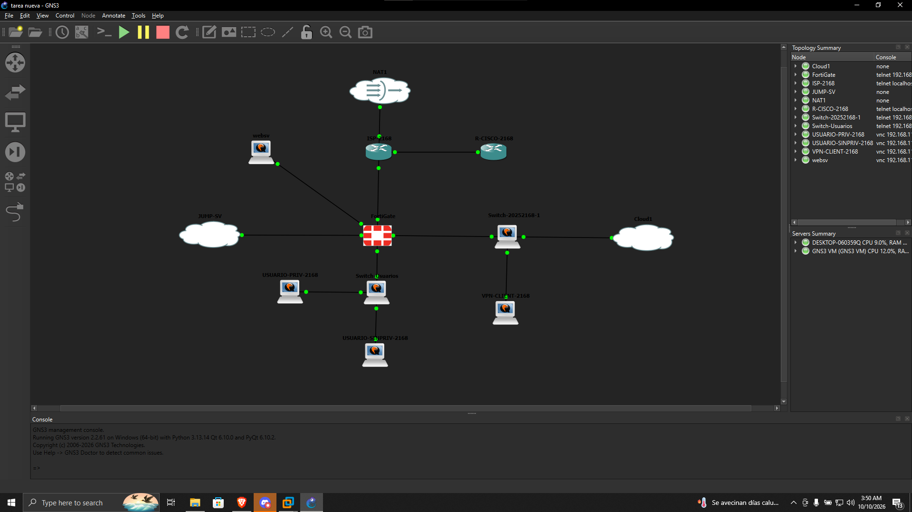

# Práctica #3 — Infraestructura #2: FortiGate, VPN IPsec y Jump Server con RDP RemoteApp

**Asignatura:** Seguridad de Redes
**Estudiante:** [Luis Roble]
**Matrícula:** [2025-2168]

---

Video: <https://youtu.be/XXXXXXXXXXX>


## 1. Objetivo

Montar un escenario con un **FortiGate** (configurado y demostrado 100 % por GUI), un **equipo de red Cisco**, un **ISP** con IPs públicas y dos servidores (**Web Server** y **Jump Server**), donde:

- Una **VPN IPsec Remote-Site** conecta al cliente con el servidor y **solo da acceso al Jump Server**.
- El **Jump Server** solo puede llegar a estos servicios del Web Server: **HTTPS, RDP y SSH**.
- Los usuarios (VLAN 10, DHCP) tienen permisos distintos según su privilegio.

Lo que se quiere demostrar:

- El FortiGate tiene las redes, rutas, objetos y políticas configurados por GUI.
- La VPN solo permite llegar al Jump Server.
- Jump Server → Web Server limitado a HTTPS, RDP y SSH.
- El **usuario sin privilegios** solo ve publicado el servicio **Web** del Jump Server y tiene políticas explícitas que le restringen el SSH hacia los servidores.
- El **usuario con privilegios** tiene publicados **Web, PuTTY y RDP** en el Jump Server.
- RDP RemoteApp y RDP RemoteApp Web Client funcionando en el Jump Server.

---

## 2. Topología



---

## 3. Direccionamiento

| Equipo | Interfaz | Dirección |
| --- | --- | --- |
| ISP | [interfaz → FortiGate] | `[IP pública]/[máscara]` |
| ISP | [interfaz → Cisco] | `[IP pública]/[máscara]` |
| FortiGate | WAN | `[IP pública]/[máscara]` |
| FortiGate | VLAN 10 (usuarios) | `[IP]/25` |
| FortiGate | LAN servidores / VPN | `[IP]/[máscara]` |
| Equipo Cisco | WAN | `[IP pública]/[máscara]` |
| Equipo Cisco | LAN Web Server | `[IP]/29` |
| Equipo Cisco | LAN Jump Server | `[IP]/29` |
| Web Server | NIC | `[IP]/29` |
| Jump Server | NIC | `[IP]/29` |
| Usuarios (VLAN 10) | DHCP | `[rango]/25` |
| Pool VPN | clientes | `[rango]` |

---

## 4. Herramientas

- [GNS3 / EVE-NG / otro]
- FortiGate VM [versión] (configuración por GUI)
- [Cisco IOS ...] para el equipo de red y el ISP
- Switch [modelo] para VLAN 10 y VPN
- Windows Server (Jump Server, RDP RemoteApp + Web Client)
- Ubuntu (Web Server, usuarios)
- PuTTY / cliente RDP / [cliente VPN]

---

## 5. Configuración

### 5.1 ISP (IPs públicas)

El ISP entrega las IPs públicas y conoce las redes de la práctica mediante rutas estáticas.


Config completa: [`Configs/ISP-2168.txt`](Configs/ISP-2168.txt)

### 5.2 Switch de usuarios (VLAN 10)

VLAN 10 para los usuarios, con trunk 802.1Q hacia el FortiGate.


Config completa: [`Configs/SW-USERS.txt`](Configs/SW-USERS.txt)

### 5.3 Switch de VPN


Config completa: [`Configs/SW- VPN.txt`](Configs/SW-%20VPN.txt)

### 5.4 Equipo de red Cisco

Conecta la red de los servidores (Web Server y Jump Server, cada uno en su propia LAN `/29`) con el ISP.

Config completa: [`Configs/CISCO-2168.txt`](Configs/CISCO-2168.txt)

### 5.5 FortiGate (todo por GUI)

**Interfaces / redes**


**Objetos (addresses)**


**Rutas estáticas**


**Políticas de firewall**


Resumen de la lógica de políticas:

| Nombre | Origen → Destino | Servicio | Acción |
| --- | --- | --- | --- |
| VPN → Jump Server | VPN-REMOTE → Jump Server | [Web / RDP / SSH] | ACCEPT |
| Jump → Web Server | Jump Server → Web Server | HTTPS, RDP, SSH | ACCEPT |
| Usuario sin privilegios → Jump | [IP user] → Jump Server | Web | ACCEPT |
| Usuario con privilegios → Jump | [IP user priv] → Jump Server | Web, PuTTY (SSH), RDP | ACCEPT |
| Deny SSH usuario sin privilegios | [IP user] → Servidores | SSH | **DENY** (explícita) |

> El orden importa: las reglas DENY explícitas deben ir **por encima** de las reglas ACCEPT generales.

**Jump Server → Web Server (HTTPS, RDP, SSH)**


Config completa: [`Configs/FortiGate.conf`](Configs/FortiGate.conf) *(sin claves ni contraseñas)*

### 5.6 VPN IPsec Remote-Site


- Autenticación: [PSK / XAUTH / certificado]
- Fase 1: [IKEv1/IKEv2, modo, propuestas]
- Fase 2: [propuestas]
- Pool de clientes: `[rango]`
- Acceso permitido: **únicamente el Jump Server**

### 5.7 Servidores

**Web Server (sistema de caja)** — LAN propia `/29`.


**Jump Server** — LAN propia `/29`, con:

- RDP RemoteApp
- RDP RemoteApp Web Client


### 5.8 Usuarios (VLAN 10, DHCP)

- **Sin privilegios:** solo tiene publicado el servicio **Web** en el Jump Server, y políticas explícitas restringen su acceso SSH a los servidores.
- **Con privilegios:** tiene publicado **Web, PuTTY y RDP** en el Jump Server.

---

## 6. Validación

### 6.1 Usuario sin privilegios

Solo el servicio Web del Jump Server.


Puertos permitidos / bloqueados desde el usuario sin privilegios:


### 6.2 Usuario con privilegios

Web, PuTTY y RDP publicados en el Jump Server.


### 6.3 SSH desde Windows al servidor Ubuntu


### 6.4 Pruebas de puertos (true / false)

Comprobación de puertos abiertos y cerrados, incluyendo el 80.


### 6.5 Logs y reportes del FortiGate

Evidencia del tráfico permitido y bloqueado.


### 6.6 Tabla de pruebas

| # | Prueba | Resultado esperado | Resultado |
| --- | --- | --- | --- |
| 1 | VPN → Jump Server | Permitido | ✅ |
| 2 | VPN → Web Server (directo) | Bloqueado | ✅ |
| 3 | Jump → Web Server HTTPS / RDP / SSH | Permitido | ✅ |
| 4 | Jump → Web Server otro puerto | Bloqueado | ✅ |
| 5 | Usuario sin priv. → Web del Jump | Permitido | ✅ |
| 6 | Usuario sin priv. → SSH a servidores | Bloqueado | ✅ |
| 7 | Usuario con priv. → Web, PuTTY, RDP en Jump | Permitido | ✅ |
| 8 | DHCP en VLAN 10 | IP asignada | ✅ |

---

## 7. Configuraciones

Carpeta [`Configs/`](Configs):

| Archivo | Equipo |
| --- | --- |
| `CISCO-2168.txt` | Equipo de red Cisco |
| `FortiGate.conf` | FortiGate |
| `ISP-2168.txt` | ISP |
| `SW- VPN.txt` | Switch de VPN |
| `SW-USERS.txt` | Switch de usuarios (VLAN 10) |

> Las configuraciones no incluyen PSK ni contraseñas reales.

---

## 8. Resultado

- El FortiGate quedó configurado completamente por GUI.
- La **VPN solo da acceso al Jump Server**.
- El **Jump Server solo alcanza HTTPS, RDP y SSH** del Web Server.
- El **usuario sin privilegios** solo usa el servicio Web del Jump Server y no puede hacer SSH a los servidores.
- El **usuario con privilegios** accede a Web, PuTTY y RDP en el Jump Server.
- RDP RemoteApp y RemoteApp Web Client operativos.

---

## Estructura del repositorio

```
PRACTICA-3-INF-2/
├── README.md
├── Configs/
│   ├── CISCO-2168.txt
│   ├── FortiGate.conf
│   ├── ISP-2168.txt
│   ├── SW- VPN.txt
│   └── SW-USERS.txt
└── IMAGENES/
    └── (capturas de topología, FortiGate, switches, VPN, servidores y pruebas)
```
